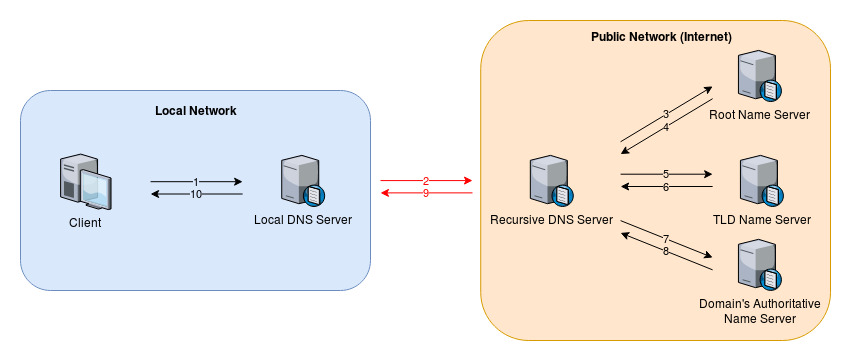
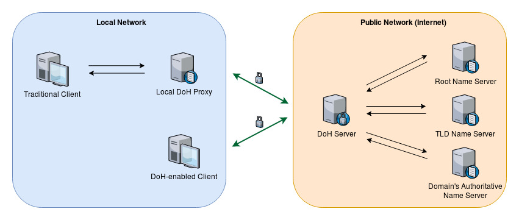
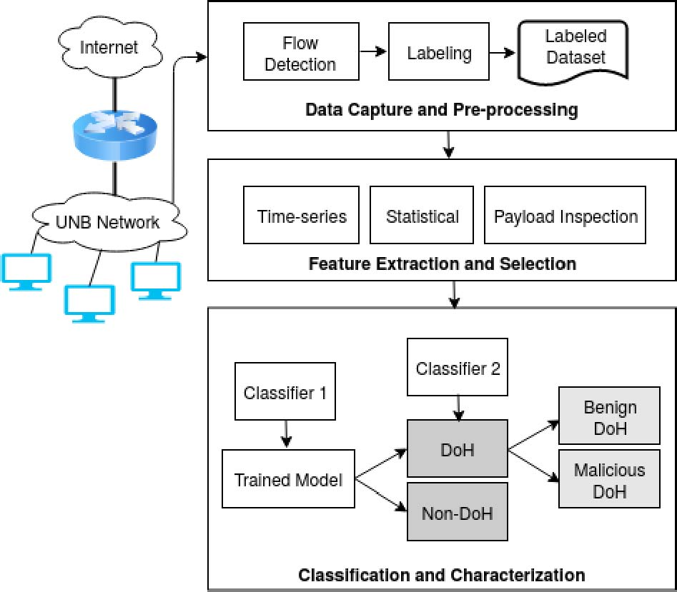
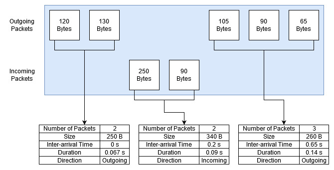
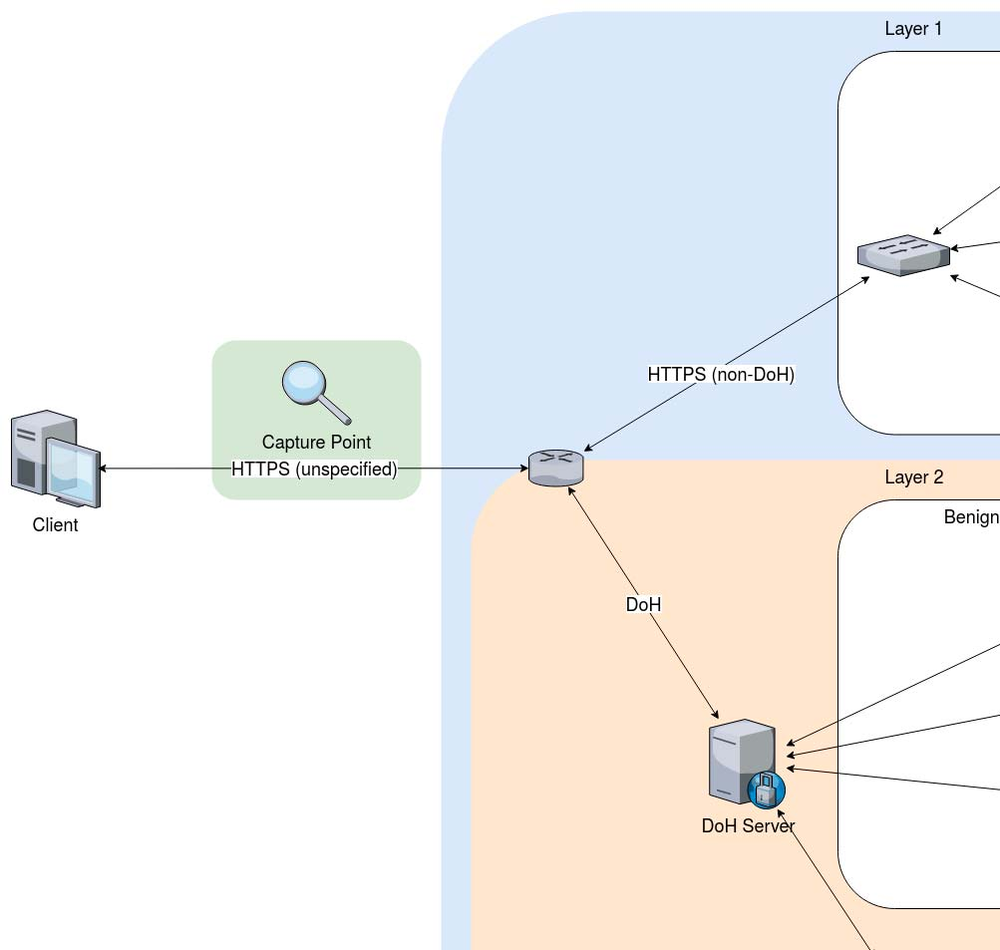
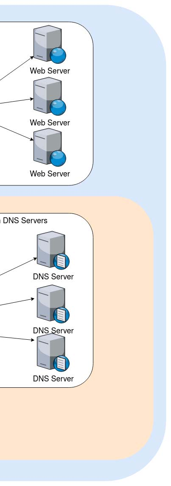
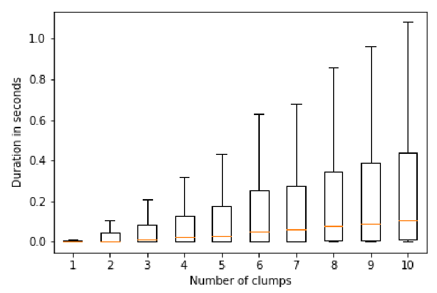
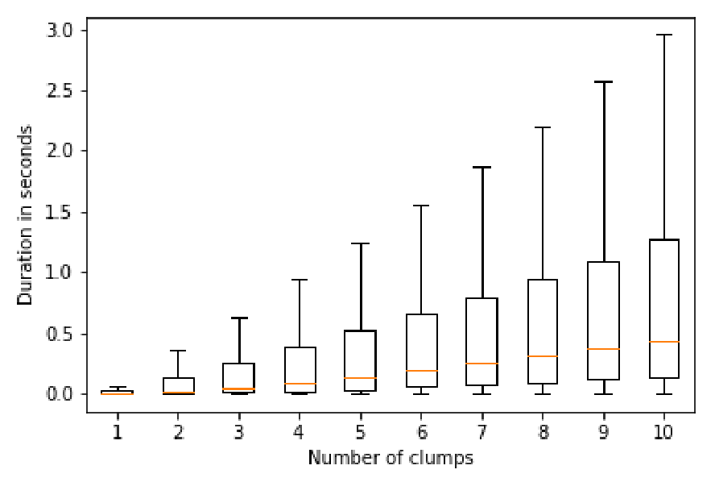
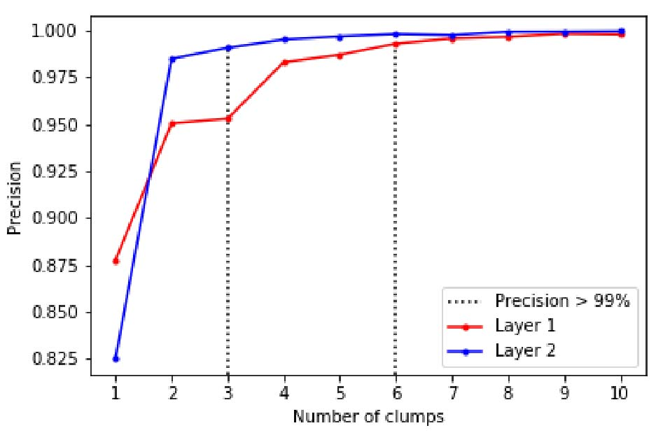

# NetworkData2

2020 IEEE Intl Conf on Dependable, Autonomic and Secure Computing, Intl Conf on Pervasive Intelligence and Computing, Intl Conf on Cloud and Big Data Computing, Intl Conf on Cyber Science and Technology Congress

# Detection of DoH Tunnels using Time-series Classification of Encrypted Traffic

Mohammadreza MontazeriShatoori, Logan Davidson, Gurdip Kaur, Arash Habibi Lashkari Canadian Institute for Cybersecurity University of New Brunswick Fredericton, New Brunswick, Canada m.montazeri,ldavids2,gurdip.kaur,a.habibi.l@unb.ca ***Abstract *—Computer** **networks** **have** **fallen** **easy** **prey** **to** **cyber** is harder to detect and block using common methods such as **attacks** **in** **the** **ever-evolving** **internet** **services.** **Domain** **Name** IP blacklisting. Many malware has already abused this method **System** **(DNS)** **has** **also** **not** **remained** **untouched** **with** **these** to exfiltrate data or to create a communication channel with **cybercrime** **attempts.** **Encrypted** **HyperText** **Transfer** **Protocol** their command-and-control servers. This helps attackers to **(HTTP)** **traffic** **over** **Secure** **Socket** **Layer** **(SSL),** **alternatively** take some degrees of control over the infected devices and **called** **HTTPS,** **has** **succeeded** **to** **prevent** **DNS** **attacks** **to** **a** potentially using them to orchestrate attacks on other targets **great** **extent.** **To** **secure** **DNS** **traffic,** **the** **security** **community** **has** **introduced** **the** **concept** **of** **DNS** **over** **HTTPS** **(DoH)** **to** such as launching DDoS attacks on online services [25].

**improve** **user** **privacy** **and** **security** **by** **combating** **eavesdropping** DNS tunnels can be detected with a variety of methods **and** **DNS** **data** **manipulation** **on** **the** **way** **to** **prevent** **Man-in-** including domain name analysis and statistical analysis of **the-Middle** **(MitM)** **attacks.** **This** **paper** **discusses** **one** **of** **the** DNS packets. Different approaches have been used to detect **persistent** **security** **concerns,** **abuse** **of** **DNS** **protocol** **to** **create** anomalous domain names, such as using statistical models.

**covert** **channels** **by** **tunneling** **data** **through** **DNS** **packets.** **We** **identify** **tunneling** **activities** **that** **utilize** **DNS** **communications** Frequency of DNS resolutions, length of the sub-domains, and **over** **HTTPS** **by** **presenting** **a** **two-layered** **approach** **to** **detect** **and** the usage of TXT records are also among variables that can **characterize** **DoH** **traffic** **using** **time-series** **classifiers.** help detect DNS tunnels [12] [21]. Blocking DNS tunnels may ***Index*** ***Terms *—DNS** **over** **HTTPS,** **DoH,** **encrypted** **traffic** **char-** be achieved through domain blacklisting, IP blacklisting, and **acterization,** **malicious** **DoH,** **machine** **learning,** **deep** **learning** dropping DNS packets that are thought to be malicious in nature.

I. INTRODUCTION

Domain Name System (DNS) is the internet backbone for providing a mapping between human-readable hostnames and computer understandable Internet Protocol (IP) addresses.

DNS protocol is designed with a decentralized hierarchical ap- proach. When a DNS client generates a DNS query asking for an IP address, the local DNS server responds after looking into its cache. It does not find the answer within cache memory, it forwards the DNS query to recursive DNS resolver which tracks down the DNS record with repetitive DNS queries to Fig. 1: Domain Name System [1] root name server, Top Level Domain (TLD) name server and authoritative name servers until it gets the target authoritative

answer [1]. Fig. 1 shows the working of the domain name system with sequence number marked on the direction of flow.

DNS tunneling is a method of using DNS protocol as a mean of encapsulating data transmission between a client and a server. The data is coded within records of an otherwise normal DNS request and the server may or may not return with some data encoded in the corresponding DNS response.

There can be different motives for using DNS as a means

of data transmission. Most importantly, many firewalls do not

Fig. 2: DNS over HTTPS (DoH)

examine the contents and frequency of DNS packets, which

DoH has already been criticized by many security re-

makes it easier for this data transmission to go unnoticed.

Secondly, since the packet will reach the modified nameservers

searchers for making DNS tunnels harder to detect and miti-

over several hops through DNS recursion, the communication

gate. First, Since the DoH wraps the DNS traffic in HTTPS,

63

978-1-7281-6609-4/20/$31.00 ©2020 IEEE

DOI 10.1109/DASC-PICom-CBDCom-CyberSciTech49142.2020.00026

<!-- Page 2 -->

the DNS traffic is imperceptible to the network infrastruc- identify end-user applications. Authors used Stacked Au- ture between the client (malware) and the DoH server. This toEncoder and Convolutional Neural Network for network effectively makes detection methods that rely on examining classification. ”ISCX VPN-nonVPN” dataset was used and the the DNS packets obsolete for the firewalls. Second, since model obtained 98% accuracy for application identification HTTP/2 is the minimum version of HTTP that DoH standard and 93% accuracy for traffic characterization. Leroux et al.

recommends for using with DoH, Malware can utilize the [11] also worked on ML models based on size and timing HTTP/2 connection to send several DoH request, without features to fingerprint VPN and ToR encrypted traffic.

creating a separate connection (or packet) for each request.

Patsakis et al. [12] investigated the use of Domain Gen- The same also applies to the responses that DoH server is eration Algorithms (DGAs) to hide malicious DNS queries sending to the malware. Through this method, malware can in a covert channel. They used Hodrick–Prescott filter to hide the frequency of their DNS resolutions, further reducing classify traffic generated through several DGAs and studied the number of methods that can detect DNS tunnels [18].

the possibility of using DNSCurve and DNSCrypt by botnets to communicate with C&C server. Their work successfully The contributions of this paper are three-fold:

constructed indicators of compromise (IoCs) even in the covert

- Presenting a novel two-layered approach to classify DoH

channel. They showcase the use of traffic analysis to provide a traffic from non-DoH traffic at layer 1 and characterize lightweight security mechanism and address future challenges DoH traffic at layer 2.

dealing with masqueraded DNS queries.

- Generating a labeled dataset by capturing Benign-DoH,

Also, a group of researchers focused on developing the Malicious-DoH and non-DoH encrypted traffic in the frameworks like MaMPF [13], Multi-Attribute Associated Fin- network premises.

gerprints (MAAF) [14], and Software Defined Network (SDN)

- Proposing a new feature-set based on time-series repre-

Home Gateway [15] to classify encrypted network traffic.

sentation of traffic flows by introducing the concept of A Quick UDP Internet Connection (QUIC) protocol based packet clumps and demonstrating the effectiveness of this CNN classifier is developed by Tong et al. [16] which used feature set in encrypted traffic characterization.

flow-based and packet-based features to identify some QUIC Rest of this paper is organised as follows. Section II gives an protocol based Google services with an accuracy of approx- overview of related work on traffic characterization. In section imately 99%. However, the model suffered from high run- III, we provide the proposed methodology followed by detailed time of processing and classification due to use of flow-based dataset in Section IV. Section V presents analyses and dis- features.

cussion of characterizing DoH traffic using a binary classifier.

Wang et al. [17] proposed an end-to-end encrypted traffic Finally, section VI concludes the paper and highlights research classification method with 1D-CNN which integrated feature opportunities in this domain.

extraction, feature selection, and classifier into one end-to-end network.

II. RELATEDWORK *B.* *DNS* *Tunneled* *Traffic* *Characterization* This section uncovers related work on encrypted and DNS tunneled traffic.

Qi et al. [19] proposed a bigram based DNS tunnel detection algorithm to define a scoring system for domain names to *A.* *Encrypted* *Traffic* *Characterization* demonstrate the frequency of their bigrams in real domains.

A thorough analysis is carried out to provide insights They used a dataset of real domains to create an online into lessons learned and challenges in the classification of classifier to detect DNS tunnels by assigning a score to each encrypted traffic using deep learning [3] [4] [5]. Yang et DNS packet in the traffic. Their result showed improvement al. [6] developed a payload-based classification method to over earlier methods that used letter frequency and reduced identify Transport Layer Security (TLS) traffic by analyzing the false positive rate significantly.

TLS connection handshake packets using the Bayesian neural Buczak et al. [21] used traffic captured at each device and network. Three parameters in the client *Hello* message viz analyzed DNS tunneled data. Authors used random forest with cipher suites, compression methods, and TLS extensions were features selected from the previous works on this area to show used to extract 392 features per flow.

that the method is sufficiently effective even when the classifier Zhang et al. in [7] used HTTP/2 based website fingerprint- had not seen the tunneling technique in the training set. They ing technique to classify encrypted TLS traffic based on local also determined the features that worked better with random request and response sequence (LRRS) feature set. Similarly, forest classifier.

Houser et al. [8] developed a DoT fingerprinting method to Ellens et al. [22] defined a flow-based DNS tunnel traffic analyze DoT traffic generated by visiting websites. Siby et detection method that grouped DNS packets with similar prop- al. [9] provided a novel approach for website fingerprinting erties. Authors captured benign traffic in the network and used by analyzing DoH and DoT traffic. They used the patterns of open-source tool to create tunneled traffic for web browsing, encrypted DNS traffic to create fingerprints for each website.

SSH communication and file transfer. Three categories of Lotfollahi et al. [10] focused on feature extraction and anomaly detectors are applied to detect anomalies in captured classification to handle network traffic characterization and data without inspecting the packets deeply. Results showed

64

<!-- Page 3 -->

feature set used, and classification technique (first contribu- that flow-based detection is promising and capable of detecting tion). Abnormal DoH detection methodology is described in all the tunnels used in the experiment irrespective of some Fig. 3 consisting of three modules: 1) Data pre-processing false-positive results.

module, 2) Feature extraction module, and 3) Classification Do et al. [24] worked on tunneling traffic in mobile net- module.

works emphasizing on bypass procedures used by some mobile applications to avoid firewalls. Authors analyzed the shortcom- *A.* *Data* *capture* *and* *pre-processing* *module* ings of payload and traffic analysis methods proposed earlier.

The training dataset contains HTTPS traffic captured using They analyzed the legitimate and malicious traffic using k- various tools (detailed in Section IV). In the next step, the data means and One Class Super Vector Machine (OCSVM) to pre-processing module identifies every flow captured from the conclude that OCSVM with some specific settings can be used encrypted network traffic by using tuple containing *<*source to detect DNS tunnels without using predetermined features IP, destination IP, source port, destination port and protocol*>*.

used by previous researchers.

Dataset is labeled based on the destination IP address of Packet-based method of classification is gaining impor- flows because the protocol (TCP) and the destination port tance since 2019 [34]. Moreover, Mouhammd and Tariq [32] (443) remain the same for all the flows. DoH flows are also presented a thorough review of available tools developed distinguished by tools used for generating them. Additionally, specifically for DNS tunneling and other tools that have DoH flows created by simulating web browsing activity are other primary purposes but utilise DNS tunneling as a data marked as benign DoH while the flows captured using DoH exfiltration method. Details of experimentation with Iodine tunnels are marked as malicious DoH. While DoH protocol DNS tunnels have been given and it was shown how DNS may theoretically be abused by attackers in a variety of ways, tunneling can encapsulate other protocols such as SSH.

we use ”malicious” label for the DoH tunneling network Liu et al. [33] discussed employing binary classifiers in traffic which can be used by malicious actors to create covert recursive DNS servers for online DNS tunnel detection and channels.

prevention. Their proposed classifier uses 18 features con-

structed from the time interval between request and response, request packet size, sub-domain entropy, and record type of DNS communications. The input to the classifier is created by using a sliding window on the pairs of DNS request/response.

Nadler et al. [25] presented an architecture for detecting and blocking high-throughput and low-throughput data exfiltration over DNS. DNS queries are collected and several features are computed over a sliding window to use in isolation forest algorithm for detecting anomaly by calculating an anomaly score. The proposed method is evaluated using a real-world dataset from several public recursive DNS servers with the high volume of DNS traffic and is found to be a more robust way of detecting DNS tunnels, especially for the malware with low throughput traffics.

Although encrypted and DNS tunneled traffic characteriza- Fig. 3: DoH traffic classification and characterization architec- tion has received tremendous research focus as evident from ture review and survey papers in the past due to its implica- *B.* *Feature* *extraction* *and* *selection* *module* tions on traffic shaping, flow control and congestion control, Feature extraction module is used to extract features from yet DoH traffic characterization is still an evolving concept.

each flow. The prominent categories of features used for The research presented in this paper attempts to detect and feature extraction as evident from review papers are time- characterize DoH traffic in an online environment. The main series, statistical and payload inspection. We present a brief superiority of the proposed method is that it needs merely overview of these features here and provide the list of features a small amount of traffic as input (less than 1 second) to used for this paper.

competitively detect and characterize DoH traffic. To the *1)* *Time-series* *features:* Time-series representation is used best of our knowledge, this is the first work on DoH traffic to model the network owing to the nature of traffic encrypted detection and characterization.

by TLS protocol in the form of a series of packets transmitted over the period. The nature of network traffic is a series of III. PROPOSEDMETHODOLOGY packets transmitting over time, so we can model a network In this section, we provide the two-layer architecture used to flow using a time-series representation of captured traffic.

classify (DoH and Non-DoH) in the first layer and characterize Since the traffic used in this work is encrypted by TLS DoH traffic (benign DoH and malicious DoH) in the second protocol, the payloads on the packets would not leak any useful layer with the detailed description of individual components, information about the nature of underlying traffic. On the

65

<!-- Page 4 -->

contrary, we can use other traffic shape parameters such as the **Algorithm** **1** Clumping Process packet size, packet direction, and the time difference between 1: **procedure** CREATE CLUMPS(*packets*) packets, to infer some information about the underlying traffic Initiate empty sequence *S* 2:

[7]. We keep the packets that contain TLS application data *currentClump**←*EMPTYCLUMP 3:

and remove insignificant packets such as ACK packets with *counter* *←*0 4:

no payload and packets too small to carry data frames. The **while** *counter* *< packets.length* **do** 5:

primary step in our method is to create packet clumps to reduce **repeat** 6:

the dimensionality of data. We define a clump of packets as Append *packets*[*counter*] to *currentClump* 7:

a sequence of one or more consecutive packets of a network *counter* *←**counter*+ 1 8:

flow (having the same source and destination) in the same *←* *packets*[*counter*]*.time* *−* *timePassed* 9:

direction to create a new and succinct representation of our *packets*[*counter**−*1]*.time* data as shown in Fig. 4 (third contribution).

= **until** *currentClump.direction* 10:

The rationale for this step is to combine these packets to *packets*[*counter*]*.direction* **or** *timePassed > timeout* find the application traffic scattered between several packets Append *currentClump* to *S* 11:

in the process of TLS segmentation and IP fragmentation. A *currentClump**←*EMPTYCLUMP 12:

threshold timeout value for clumps is also considered so that **end** **while** 13:

two packets with a greater time difference do not end up in **return** *S* 14:

the same packet clump. Algorithm 1 describes the clumping 15: **end** **procedure** process. Each clump C is denoted by 5-tuple characteristics as:

*2)* *Payload* *inspection* *features:* Since TLS traffic is en- *C* =*⟨**size, pktCount, direction, duration, interarrival**⟩* crypted, only the unencrypted handshake packets can be in- spected. Following parameters in client *Hello* message can be By using the clumping process, a sequence of clumps for any used for application fingerprinting from these packets: list of traffic flow is defined as available cipher suites, list of available compression methods, and list of available TLS extensions [6]. A fingerprint for each *S* = (*C*1*, . . . , C**n*) flow can be generated since each client has its own parameters for each flow. Although this fingerprinting method can be used The size of these sequences (*n*) depends on the flow. We to classify flows by clients yet it is not robust for detecting use a sliding window with a size of *ℓ*over this sequence malicious tunneling traffic because it is limited to known client of clumps to generate clump segments. Sequences that are fingerprints only.

smaller than the segment size are padded with empty clumps.

*3)* *Statistical* *features:* Statistical features are considered Using*ℓ*as a hyper-parameter specifying the number of clumps powerful for performing analyses. There are several related in a segment, the final feature set *F**ℓ*extracted from a flow is works on this domain which have used statistical features like represented as:

duration of the flow, inter-arrival time etc. [28] [29]. Based on *F**ℓ*=*{*(*C**i**, ..., C**i*+*ℓ*)*|*1*≤**i <**|**S**| −**ℓ**}* features used by these papers and our experiments, we have selected and developed 28 statistical features from captured Finding the best value for *ℓ*is a trade-off between accuracy DoH traffic as shown in Table I. To create the DoH flows and response time. A smaller*ℓ*potentially limits the ability of (the combination of all request and response packets in one the classifier to find meaningful patterns in the traffic. Thereby, connection) and extract these features, we developed an open- it decreases the accuracy of results and time needed to capture source package by Python named DoHMeter which is publicly traffic. In other words, it helps to detect and discard malicious available in GitHub [23].

traffic earlier.

*C.* *Classification* *module*

Classification module is first used to train the classifier and create a trained model which is used to distinguish DoH traffic from non-DoH traffic at layer 1. After getting DoH traffic at layer 1, it is characterized as benign and malicious DoH traffic at layer 2.

*1)* *Statistical* *features* *classifier:* We used Random For- est (RF), Decision Tree (C4.5), Support Vector Machines (SVM), and Naive Bayes (NB) machine learning algorithms and deep neural network (DNN) and convolutional neural network (CNN) to classify statistical representation of flows.

The results of these classifiers are compared to obtain the best Fig. 4: Clumping process classifier for our data. It is imperative to mention here that

66

<!-- Page 5 -->

TABLE I

STATISTICAL FEATURES

|Parameter|Feature|
|---|---|
|F1|Number of flow bytes sent|
|F2|Rate of flow bytes sent|
|F3|Number of flow bytes received|
|F4|Rate of flow bytes received|
|F5-F12|Packet Length (F5: Mean, F6: Median, F7: Mode, F8: Variance, F9: Standard deviation, F10: Coefficient of variation, F11: Skew from median, F12: Skew from mode)|
|F13-20|Packet Time (F13: Mean, F14: Median, F15: Mode, F16: Variance, F17: Standard deviation, F18: Coefficient of variation, F19: Skew from median, F20: Skew from mode)|
|F21-F28|Request/response time difference (F21: Mean, F22: Median, F23: Mode, F24: Variance, F25: Standard deviation, F26: Coefficient of variation, F27: Skew from median, F28: Skew from mode)|

Fig. 5: Network diagram used to capture traffic simple tools such as curl.The web browsers were configured to we used DoHMeter to extract features from our dataset before use various public DoH resolvers. Our web browsing dataset applying statistical classifiers.

generation was implemented by using Python. We used the *2)* *Time-series Classifier:* For classifying time-series repre- Selenium library, a front-end testing tool, in our Python script sentations of our flows, we pre-processed the dataset to create to communicate with the web browsers. To connect to Firefox, clumps of data as explained in the previous subsection and we also used GeckoDriver which is an intermediary between then used deep learning classifiers to create a model capable of Firefox and tools that interacts with Firefox. Since we did not classifying sequences of clumps. Unlike the statistical features need to interact graphically with the web browser, we used classifier that uses features calculated from the whole flow, a headless Firefox process that does not bring up the GUI.

time-series classifier can utilize a limited number of clumps to Furthermore, we set up Firefox in a way that used DoH instead classify the flow. We used a deep neural network with 4 hidden of DNS, so that all the name resolution traffic happens to be layers (including an LSTM layer at the second hidden layer) DoH and could be captured. Similarly, for Google Chrome, to create our model. We used DoHlyzer which is a DoH traffic we used chrome driver to communicate with the browser.

flow generator and analyzer for anomaly and attack detection To create the malicious records of our dataset we deployed a and characterization. DoHlyzer is a script written in python network that can be used to simulate DoH tunneling scenarios.

that uses Scapy to read pcap files or sniff packets online. The This is achieved by setting up a domain, setting our authorita- tool is publicly available at [26].

tive server as the nameserver for that domain, and using DoH IV. DATASET AND EXPERIMENTS requests/responses to carry data between client and server.

Since the DoH protocol is backwards compatible with DNS Our generated dataset, named *CIRA-CIC-DoHBrw-2020*, is authoritative nameservers, we used the existing DNS tunneling publicly available at [27]. It consists of HTTPS traffic flows tools to setup our authoritative server. For the client, we used with two levels of distinct labels. We have DoH and Non- a DoH proxy to encapsulate every DNS requests received by DoH HTTPS traffic at the first layer, and in the next layer, the client into a DoH connection with a DoH Server and relay the DoH traffic is segregated as Benign DoH and Malicious the response it received from the DoH server to the client as DoH (second contribution). Although malicious traffic can be DNS records. Data is captured between the DoH proxy and tunneling as well as non-tunneling but we generated only DoH server. This set up allowed up to simulate DoH tunnels tunneled malicious traffic for this research. We used a variety using various DNS tunneling tools that are used in the relevant of tools to simulate network activity to generate these flows studies [30]. To label the training dataset, these simulations as shown in Fig. 5. Firstly, normal web browsing activity that were done separately in an isolated network so that any traffic includes non-DoH HTTPS and benign DoH is simulated using captured can be associated with the correct label.

Mozilla Firefox and Google Chrome web browsers. Secondly, malicious DoH is generated by a combination of tools used to We developed a tool named*DoH Data Collector*to simulate create DoH tunnels as further detailed in this section. Traffic different DoH tunneling scenarios and capture the resulting generated by all these tools is captured for pre-processing and HTTPS traffic. In each instance of simulation, a new DoH training the classifiers.

tunnel is made over the underlying network according to To simulate web browsing network activity, we captured different parameters used in a scenario such as:

HTTPS traffic from web browsers when visiting a series of

1. DoH Server: Adguard, Cloudflare, Google, Quad9

top 10k Alexa websites [20]. Since lazy loading of data is

2. DNS Tunneling Tool: Iodine, DNS2TCP, DNScat2

common in current web ecosystem, we refrained from using

67

<!-- Page 6 -->

V. ANALYSES ANDDISCUSSION

3. Tunneling Client and Server Configurations: Settings

such as the delay between sending requests and DNS This section presents major findings and discussion of our record types used.

research by analyzing the experimentation results in both

4. Transmission Rate: Random value between 100 B/s to

layers of classification.

1100 B/s *A.* *Classification* *by* *Statistical* *Features* *of* *the* *Flows*

5. Duration

The results of classification of HTTPS traffic at layer 1 To generate enough data, the clients used in the simulation (DoH/non-DoH classes) using statistical features are presented were run simultaneously on 10 servers, all connecting to a sin- in Table III. All the standard machine learning and deep neural gle C2 server posing as a DNS nameserver. A central controller network (DNN) and convolutional neural network (CNN) based on another server controls the timing of simulations.

classifiers use statistical features calculated from the entire This controller reads the scenarios from a configuration file flow. Thus, it is important to investigate the duration of with JSON format that defines each of the scenarios and these flows for early detection of DoH traffic by an online uses SSH to access the clients and the server remotely to set classifier. All the classifiers share a mean delay of 20.393 up the simulation. Each simulation starts by running the C2 seconds to detect whether a flow can be regarded as DoH.

server application (such as Iodine) followed by running the Apparently, random forest (RF) and C4.5 produced equivalent client DoH proxies (which wraps DNS communications in a classification results with equal precision, recall and f-score DoH connection) and the C2 client applications. During the value. It is followed by the support vector machine (SVM) simulation, a TCP connection with the specified transmission and Naive Bayes (NB) at 0.877 and 0.84 precision, recall rate is tunneled through the C2 connection to generate the and f-score value respectively. We also evaluated deep neural DoH traffic. We captured the traffic between the DoH proxy network and two-dimensional (2D) CNN on the generated and DoH server using *tcpdump*.

dataset with 0.97 and 0.98 precision respectively.

TABLE II DATASET DETAILS TABLE III DoH TRAFFIC CLASSIFICATION BY ML/DL

|Browser/Tool|DoH Server|Packets|Flows|Type|
|---|---|---|---|---|
|Google Chrome|AdGuard|5609K|105141|HTTPS (Non-DoH and Benign DoH)|
||Cloudflare|6117K|132552||
||Google DNS|5878K|108680||
||Quad9|10737K|199090||
|Mozilla Firefox|AdGuard|4943K|50485||
||Cloudflare|4299K|90260||
||Google DNS|6413K|138422||
||Quad9|4956K|92670||
|dns2tcp|AdGuard|1281K|5459|Malicious DoH|
||Cloudflare|3694K|6045||
||Google DNS|28711K|17423||
||Quad9|8750K|138588||
|DNSCat2|AdGuard|1301K|5369||
||Cloudflare|12346K|9230||
||Google DNS|48069K|11915||
||Quad9|19309K|9108||
|Iodine|AdGuard|3938K|11336||
||Cloudflare|5932K|14110||
||Google DNS|73459K|12192||
||Quad9|22668K|8975||

|Classifier|Precision|Recall|F-Score|Flow Duration (s)||
|---|---|---|---|---|---|
|||||Mean|Median|
|RF|0.993|0.993|0.993|20.393|1.397|
|C4.5|0.993|0.993|0.993|||
|SVM|0.877|0.877|0.877|||
|NB|0.84|0.834|0.833|||
|DNN|0.97|0.97|0.97|||
|2D CNN|0.98|0.98|0.98|||

TABLE IV DoH CHARACTERIZATION BY ML/DL

|Classifier|Precision|Recall|F-Score|Flow Duration (s)||
|---|---|---|---|---|---|
|||||Mean|Median|
|RF|0.999|0.999|0.999|53.924|34.064|
|C4.5|0.999|0.999|0.999|||
|SVM|0.89|0.885|0.884|||
|NB|0.836|0.833|0.832|||
|DNN|0.98|0.98|0.98|||
|2D CNN|0.99|0.99|0.99|||

Working on all of the captured traffic, DoHMeter [23] was The same feature set and classifiers are used at layer 2 to used to extract statistical and time-series features as mentioned distinguish between malicious DoH (generated by tunneling in subsection III-B from the pcap files. Table II presents the activity) and benign DoH. Results presented in Table IV details of captured packets and generated flows for different show the same pattern as layer 1 suggesting the advantage browsers and tools on four different DoH servers. A small number of flows (*n* *<* 50) in captured dataset contained of utilizing the combination of statistical features and decision tree learning models. The increased flow duration from 20.393 NaN values for some of the features, mostly because the seconds at layer 1 to 53.924 seconds at layer 2 indicates flow did not contain enough packets for those features to that DoH flows generally last longer compared to other non- be calculated. These flows were deleted as part of the data DoH/HTTPS flows. All these classifiers give excellent results pre-processing/cleaning procedure. The resulting dataset was divided to the training set (80% of the flows) and test set (the at both layers until we bring into consideration the fact the remaining 20%), to be used with all the classifiers discussed nature of DNS request-response pairs which is extremely short in duration to detect encrypted and DoH traffic. To overcome in this paper.

68

<!-- Page 7 -->

this drawback, we formed clump sequence duration and results We consider the plot in Fig. 6 to actuate the threshold are explained in next sub-section.

value for the number of clumps after which DoH flows can be classified at layer 1 and characterized at layer 2. It is observed *B.* *Classification* *by* *Time-series* *Features* *of* *the* *Flows* that after six clumps in layer 1 and three clumps at layer 2, the precision hikes beyond 0.99 offering a precision comparable We introduced *packet* *clumps* and *clump* *segments* to find with the most accurate statistical classifiers.

patterns in a limited window of traffic which in turn re-

duces detection latency. We deployed long short-term memory (LSTM) a prominent recurrent neural network (RNN) archi- tecture to create deep learning binary classifiers at both layers.

Tables V and VI detail the results of using the proposed time- series feature set in combination with LSTM architecture. It gives an ostensible picture of how the value of all evaluation metrics keeps on escalating with the number of clumps (*ℓ*) formed at very short flow duration.

TABLE V (a) Layer 1 DoH TRAFFIC CLASSIFICATION BY LSTM

|ℓ|Precision|Recall|F1-Score|Duration (s)||
|---|---|---|---|---|---|
|||||Mean|Median|
|1|0.877|0.876|0.876|0.081|0.000|
|2|0.950|0.949|0.949|0.167|0.002|
|3|0.953|0.951|0.951|0.262|0.010|
|4|0.983|0.983|0.983|0.366|0.020|
|5|0.987|0.987|0.987|0.468|0.030|
|6|0.993|0.993|0.993|0.574|0.047|
|7|0.996|0.996|0.996|0.675|0.060|
|8|0.996|0.996|0.996|0.775|0.077|
|9|0.998|0.998|0.998|0.871|0.091|
|10|0.998|0.998|0.998|0.964|0.105|

(b) Layer 2 Fig. 7: Distribution of clump sequence duration TABLE VI To further analyze the clumping process used in our re- DoH CHARACTERIZATION BY LSTM search, we mapped out a diagram between the number of clumps and distribution of clump segment duration in both

|ℓ|Precision|Recall|F1-Score|Duration (s)||
|---|---|---|---|---|---|
|||||Mean|Median|
|1|0.825|0.792|0.782|0.164|0.002|
|2|0.985|0.984|0.985|0.329|0.022|
|3|0.991|0.991|0.991|0.502|0.05|
|4|0.995|0.995|0.995|0.685|0.094|
|5|0.997|0.997|0.997|0.872|0.142|
|6|0.998|0.998|0.998|1.063|0.203|
|7|0.997|0.997|0.997|1.26|0.258|
|8|0.999|0.999|0.999|1.45|0.313|
|9|0.999|0.999|0.999|1.63|0.373|
|10|0.999|0.999|0.999|1.803|0.44|

layers in Fig. 7. With regards to the threshold value *ℓ*1 *≥*6 for the first layer, we can derive that a DoH connection can be detected roughly under 0.8 seconds since all the segments with six clumps created from the layer 1 traffic have values less than 0.8 (excluding the statistically insignificant outliers).

The same conclusion can be made for layer 2 with a threshold value of *ℓ*2 *≥*3, placing the delay of our proposed time-series classifier at less than 1 second for DoH tunnel detection.

VI. CONCLUSION AND FUTURE SCOPE We presented the exploitation of DNS protocol to create covert channels by tunneling data through DoH connections.

DoH was successfully deployed through web browsers and DNS tunneling tools to generate and capture benign and malicious DoH flows along with encrypted traffic. We used sta- tistical features to detect DoH connections and malicious DoH activity (DoH tunneling) in a two-layered binary classification approach where the first layer distinguishes DoH traffic from non-DoH traffic and the second layer characterizes malicious and benign DoH flows.

We demonstrated that malicious DoH traffic can be ac- curately detected by using the proposed two-layer binary Fig. 6: Comparison of precision values at both layers classification architecture. Moreover, we dealt with latency as

69

<!-- Page 8 -->

a significant constraint when analyzing DoH request-response [16] V. Tong, A. Tran, S. Souihi, A. Mellouk, A Novel QUIC Traffic Classifier Based on Convolutional Neural Networks. 2018 IEEE Global flows. We showed that clumping process facilitated early Communications Conference, pp. 1–6, 2018 analysis of traffic allowing to create time-series classifiers [17] W. Wang, M. Zhu, J. Wang, X. Zeng, Z. Yang, End-to-end encrypted capable of timely detection of malicious traffic while retaining traffic classification with one-dimensional convolution neural networks.

2017 IEEE International Conference on Intelligence and Security Infor- the accuracy of statistical classifiers.

matics, pp. 43–48, 2017 DoH was designed and implemented fairly recently espe- [18] D.

Hjelm, A New Needle and Haystack:

Detecting DNS cially in comparison to DNS. Therefore, it leverages a wide over HTTPS Usage.

Available at https://www.sans.org/reading- room/whitepapers/dns/needle-haystack-detecting-dns-https-usage- scope for research in security and privacy issues that may 39160, Last accessed April 27, 2020 arise from its widespread adoption. In the future work, our [19] C. Qi, X. Chenb, C. Xu, J. Shia, P. Liu, A Bigram Based Real Time DNS objective is to focus on security vulnerabilities arising from Tunnel Detection Approach, Information Technology and Quantitative Management, Procedia Computer Science, Vol. 17, pp. 852-860, 2013 other methods of DoH deployment in the network, especially [20] Alexa, https://www.alexa.com/, Last accessed December 10, 2019 local DoH proxies deployed in the network providing DoH [21] A. Buczak, P. Hanke, G. Cancro, M. Toma, L. Watkins, J. Chavis, service (DoHS).

Detection of Tunnels in PCAP Data by Random Forests, Proceedings of the 11th Annual Cyber and Information Security Research Conference, ACKNOWLEDGEMENT pp. 1-4, 2016 [22] W. Ellens, P. ˙Zuraniewski, A. Sperotto, H. Schotanus, M. Mandjes, This research is supported by the Canadian Internet Regis- E. Meeuwissen, Flow-Based Detection of DNS Tunnels, In: Doyen G., Waldburger M., ˇCeleda P., Sperotto A., Stiller B. (eds) Emerging tration Authority (CIRA)’s community investment program.

Management Mechanisms for the Future Internet, Lecture Notes in REFERENCES Computer Science, Vol. 7943, Springer, Berlin, Heidelberg, 2013 [23] DoHlyzer, https://github.com/ahlashkari/DOHlyzer/tree/master/DoHMeter, [1] Domain Name System - Request For Comments 1034, 2019 https://tools.ietf.org/html/rfc1034, Last accessed December 03, 2019 [24] V. Do, P. Engelstad, B. Feng, T. Do, Detection of DNS tunneling in [2] DNS Queries over HTTPS (DoH) - Request For Comments 8484, mobile networks using machine learning, In: Kim K., Joukov N. (eds) https://tools.ietf.org/html/rfc8484, Last accessed December 03, 2019 Information Science and Applications 2017, Lecture Notes in Electrical [3] F. Pacheco, E. Exposito, M. Gineste, C. Baudoin, J. Aguilar, Towards Engineering, Vol. 424, Springer, Singapore, 2017 the Deployment of Machine Learning Solutions in Network Traffic [25] A. Nadler, A. Aminov, A. Shabtai, Detection of malicious and low Classification: A Systematic Survey. IEEE Communications Surveys and throughput data exfiltration over the DNS protocol, Computers & Tutorials, 21(2), pp. 1988-2014, 2019 Security, Vol. 80, pp. 36-53, 2019 [4] G. Aceto, D. Ciuonzo, A. Montieri, A. Pescap´e, Mobile encrypted traffic [26] DoHlyzer, https://github.com/ahlashkari/DOHlyzer, 2019 classification using deep learning: Experimental evaluation, lessons [27] CIRA-CIC-DoHBrw-2020, https://www.unb.ca/cic/datasets/dohbrw- learned, and challenges. IEEE Transactions on Network and Service

2020. html, 2020

Management, 16(2), pp. 445–458, 2019 [28] L. Arash, D. Gerard, M. Mohammad, G. Ali, Characterization of [5] S. Rezaei, X. Liu, Deep Learning for Encrypted Traffic Classification:

Tor Traffic Using Time-Based Features. In the proceeding of the 3rd An Overview. IEEE Communications Magazine, 57(5), pp. 76–81, 2019 International Conference on Information System Security and Privacy, [6] J. Yang, J. Narantuya, H. Lim, Bayesian Neural Network Based En- SCITEPRESS, Portugal, pp. 253-262, 2017 crypted Traffic Classification using Initial Handshake Packets. Proceed- [29] D. Gerard, L. Arash, M. Mohammad, G. Ali, Characterization of En- ings - 49th Annual IEEE/IFIP International Conference on Dependable crypted and VPN Traffic Using Time-Related Features, In Proceedings Systems and Networks - Supplemental Volume, pp. 19–20, 2019 of the 2nd International Conference on Information Systems Security [7] Z. Zhang, C. Kang, G. Xiong, Z. Li, Deep Forest with LRRS Feature and Privacy, pp. 407-414, Italy, 2016 for Fine-grained Website Fingerprinting with Encrypted SSL/TLS. Pro- [30] A. Merlo, G. Papaleo, S. Veneziano, M. Aiello, A Comparative Perfor- ceedings of the 28th ACM International Conference on Information and mance Evaluation of DNS Tunneling Tools, In: Herrero ´A., Corchado Knowledge Management, pp. 851–860, 2019 E. (eds) Computational Intelligence in Security for Information Sys- [8] H. Rebekah, L. Zhou, C. Chase, W. Haining, An Investigation on tems, Lecture Notes in Computer Science, Vol. 6694, Springer, Berlin, Information Leakage of DNS over TLS, In Proceedings of the 15th Heidelberg, 2011 International Conference on Emerging Networking Experiments And [31] R. Hasibi, M. Shokri, M. Dehghan, Augmentation Scheme for Dealing Technologies, 2019 with Imbalanced Network Traffic Classification Using Deep Learning, [9] S. Sandra, J. Marc, D. Claudia, V. Narseo, T. Carmela, Encrypted DNS

2019. Available at http://arxiv.org/abs/1901.00204
- Privacy? A Traffic Analysis Perspective.Cryptography and Security,

[32] Al-kasassbeh, Mouhammd, and Tariq Khairallah. , Winning tactics with Cornell University, 2019. Available at https://arxiv.org/abs/1906.09682 DNS tunnelling, Network Security, Vol 12, 2019 [10] M. Lotfollahi, M. Siavoshani, Z. Shirali, M. Saberian, Deep packet: a [33] J. Liu, S. Li, Y. Zhang, J. Xiao, P. Chang and C. Peng, Detecting DNS novel approach for encrypted traffic classification using deep learning.

tunnel through binary-classification based on behavior features. 2017 Soft Computing, pp. 1-14, 2019 IEEE Trustcom/BigDataSE/ICESS. IEEE, 2017 [11] S. Leroux, S. Bohez, J. Maenhaut, N. Meheus, P. Simoens, B. Dhoedt, [34] C. Liu, L. Dai, W. Cui and T. Lin, A Byte-level CNN Method to Detect Fingerprinting encrypted network traffic types using machine learning.

DNS Tunnels, 2019 IEEE 38th International Performance Computing IEEE/IFIP Network Operations and Management Symposium: Cognitive and Communications Conference (IPCCC), IEEE, 2019 Management in a Cyber World, 1–5, 2018 [12] C. Patsakis, F. Casino, V. Katos, Encrypted and covert DNS queries for botnets: Challenges and countermeasures, Computers & Security, 88, 2020 [13] C. Liu, Z. Cao, G. Xiong, G. Gou, M. Yiu, L. He, MaMPF: Encrypted Traffic Classification Based on Multi-Attribute Markov Probability Fin- gerprints. 2018 IEEE/ACM 26th International Symposium on Quality of Service, pp. 1–10, 2018 [14] Y. Chen, T. Zang, Y. Zhang, Y. Zhou, Y. Wang, Rethinking Encrypted Traffic Classification: A Multi-Attribute Associated Fingerprint Ap- proach. 2019 IEEE 27th International Conference on Network Protocols, pp. 1–11, 2019 [15] P. Wang, F. Ye, X. Chen, Y. Qian, Datanet: Deep Learning Based Encrypted Network Traffic Classification in SDN Home Gateway. IEEE Access, 6, pp. 55380–55391, 2018

70
